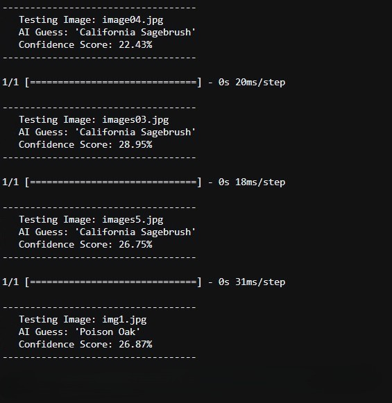
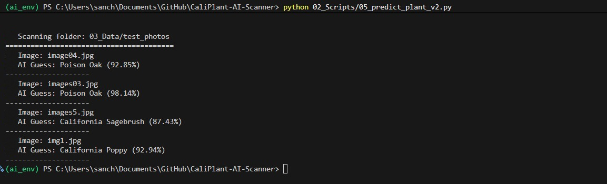
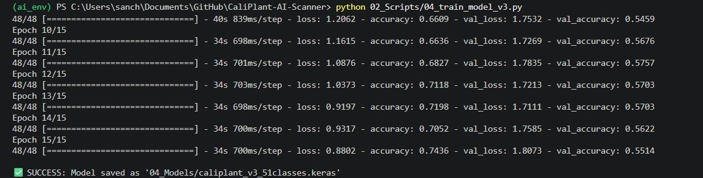
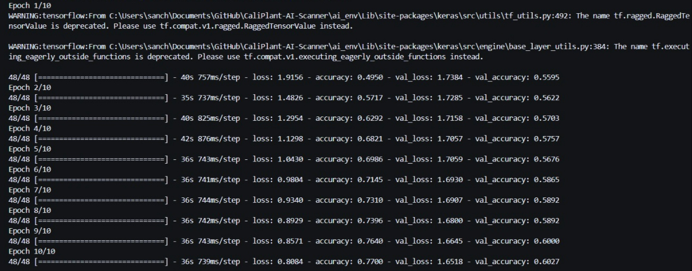

# CaliPlant AI: Fine-Tuned MobileNetV2 Botanical Classification System

[](https://www.python.org/)
[](https://www.tensorflow.org/)
[](https://keras.io/)
[](https://streamlit.io/)
[](#13-license)

A production-grade deep learning system for identifying 51 native and common California plant species from a single uploaded image. CaliPlant AI is built on a fine-tuned MobileNetV2 backbone with fully in-graph preprocessing, and is deployed through an interactive Streamlit interface that returns species predictions alongside detailed botanical metadata, including native status, water requirements, and toxicity information.

---

## Table of Contents

1. [Abstract](#1-abstract)
2. [Problem Statement](#2-problem-statement)
3. [Model Evolution Journey (V1 to V5)](#3-model-evolution-journey-v1-to-v5)
4. [Infrastructure and Data Engineering Challenges](#4-infrastructure-and-data-engineering-challenges)
5. [Final Production Architecture: Model V5](#5-final-production-architecture-model-v5)
6. [Dataset](#6-dataset)
7. [Sample Predictions and Inference Showcase](#7-sample-predictions-and-inference-showcase)
8. [Repository Directory Structure](#8-repository-directory-structure)
9. [Installation and Local Deployment](#9-installation-and-local-deployment)
10. [Inference Contract](#10-inference-contract)
11. [User Interface Walkthrough](#11-user-interface-walkthrough)
12. [Tech Stack](#12-tech-stack)
13. [License](#13-license)
14. [Author](#14-author)
15. [Acknowledgements](#15-acknowledgements)
---

## **1. Abstract**

Botanical identification from images is a deceptively difficult fine-grained visual classification problem. Unlike broad object categories, plant species within the same genus or growth habit often differ only in subtle leaf venation, margin serration, or floral micro-structure, features that generic image classifiers frequently fail to separate.

<br>
<p align="center">
  
  
</p>
<p align="center">
  
  
</p>

CaliPlant AI addresses this through an iterative, five-phase model development process, progressing from a shallow custom CNN trained from scratch to a deeply fine-tuned MobileNetV2 network with in-graph preprocessing and selective backbone unfreezing. The final production model, V5, classifies 51 distinct California plant species and achieves a validation accuracy of 86.09 percent, with the complete inference pipeline, including pixel scaling, wrapped directly inside a single Keras model graph to eliminate deployment-time normalization mismatches.

<br><br>
<p align="center">
  
  
</p>
<p align="center">
  
  
</p>

The system is served through a Streamlit application that accepts an uploaded image, runs inference through a cached model instance, and renders the top prediction together with its scientific name, native status, water needs, an educational fact, a toxicity notice, and the top three ranked predictions.

---

## 2. Problem Statement

Fine-grained plant classification carries three compounding difficulties that shaped every architectural decision in this project:

* **Low inter-class variance.** Species in the same family frequently share overall silhouette and color palette, so the decision boundary depends on fine texture and edge detail rather than coarse shape.
* **High intra-class variance.** A single species photographed in different lighting, growth stages, and backgrounds produces a wide visual spread, which a model must learn to see through.
* **Data scarcity.** Unlike commercial agricultural datasets, an open dataset of curated, correctly labeled images across all 51 target species does not exist off the shelf, so the dataset itself had to be built, cleaned, and verified from scratch before any modeling could begin.

These constraints ruled out a simple from-scratch CNN early on and pushed the project toward transfer learning, then toward increasingly careful fine-tuning of the pretrained backbone, as documented phase by phase below.

---

## 3. Model Evolution Journey (V1 to V5)

The full engineering journal behind this section lives in `00_Documentation/00_Project_Documentation.ipynb`. Every version below was a direct, targeted response to a specific failure diagnosed in the version before it.

### **Phase 1**: Model V1 — Custom CNN From Scratch

**Design rationale.** Before reaching for a pretrained backbone, the project first tested whether a basic convolutional network could learn geometric plant features from the target distribution directly, without external weight bias, on a narrowed 5-class subset.

**Architecture.**
```python
model = models.Sequential([
    layers.Conv2D(32, (3, 3), activation='relu', input_shape=(224, 224, 3)),
    layers.MaxPooling2D((2, 2)),
    layers.Conv2D(64, (3, 3), activation='relu'),
    layers.MaxPooling2D((2, 2)),
    layers.Conv2D(128, (3, 3), activation='relu'),
    layers.MaxPooling2D((2, 2)),
    layers.Flatten(),
    layers.Dense(256, activation='relu'),
    layers.Dense(5, activation='softmax')
])
```

**Data flow.** Images resized to `(224, 224, 3)`, rescaled by `1./255` via a basic `ImageDataGenerator`, with no spatial augmentation.

**Failure diagnosis.** The model underfit severely. Training loss flattened after a handful of epochs and both training and validation accuracy stalled near random-guess levels. Root causes: a 3-layer CNN has neither the depth nor the receptive field needed to capture microscopic botanical structures such as leaf margins and branching veins, and training from randomly initialized weights on a small, complex dataset produced unstable gradient flow that stalled in poor local minima.

<p align="center">
  
</p>

---

### **Phase 2**: Model V2 — Frozen MobileNetV2 Proof of Concept

**Design rationale.** With roughly 100 images per class available at this stage, training a deep network from scratch was infeasible. The project pivoted to transfer learning, introducing a frozen MobileNetV2 backbone pretrained on ImageNet, still restricted to the simplified 5-class task to validate the approach cheaply.

**Architecture and configuration.**
```python
base_model = MobileNetV2(input_shape=(160, 160, 3), include_top=False, weights='imagenet')
base_model.trainable = False

model = models.Sequential([
    base_model,
    layers.GlobalAveragePooling2D(),
    layers.Dropout(0.2),
    layers.Dense(5, activation='softmax')
])
```

Input resolution was compressed to `160x160` to accelerate training, batch size was set to a volatile `4`, and mild augmentation (`rotation_range=20`, `horizontal_flip=True`) was introduced. The network was compiled with the default Adam optimizer.

**Failure diagnosis.** The model converged quickly on the 5-class subset, but two terminal bottlenecks emerged when considering scale-up to the full problem: compressing images to 160x160 stripped away the fine leaf texture and venation detail needed to separate similar species, and a batch size of 4 produced highly volatile gradient steps that would not have converged reliably on a much more granular 51-class distribution.

<p align="center">
  
</p>

---

### **Phase 3**: Model V3 — Full 51-Class Scale-Up

**Design rationale.** Having validated that a pretrained backbone outperforms a scratch network, V3 scaled the problem up to the full, real-world target of 51 species, which required restoring full input resolution, stabilizing batch dynamics, and substantially increasing data augmentation to compensate for a still-limited dataset.

**Augmentation configuration.**
```python
train_datagen = ImageDataGenerator(
    rotation_range=30,
    width_shift_range=0.2,
    height_shift_range=0.2,
    shear_range=0.2,
    zoom_range=0.2,
    horizontal_flip=True,
    fill_mode='nearest'
)
```

**Architecture.**
```python
base_model = tf.keras.applications.MobileNetV2(
    input_shape=(224, 224, 3),
    include_top=False,
    weights='imagenet'
)
base_model.trainable = False  # Entire backbone kept frozen

model = models.Sequential([
    base_model,
    layers.GlobalAveragePooling2D(),
    layers.Dense(512, activation='relu'),
    layers.Dropout(0.4),
    layers.Dense(51, activation='softmax')
])
```

Input resolution was restored to `224x224`, batch size was stabilized at `32`, and the model was trained for 15 epochs.

**Failure diagnosis.** Training ran cleanly across all 51 classes without crashing, but validation accuracy hit a hard ceiling and plateaued. Because the entire MobileNetV2 backbone remained frozen, the dense head alone had to learn the full 51-way decision boundary from generic ImageNet filters, which excel at broad, everyday visual distinctions but lack the specialized botanical filters needed to separate closely related plant species.

<p align="center">
  
</p>

---

### **Phase 4**: Model V4 — Selective Backbone Fine-Tuning

**Design rationale.** To break past the V3 plateau, the strategy shifted from static feature extraction to active fine-tuning, carefully unfreezing the deepest convolutional blocks of MobileNetV2 so backpropagation could specialize their pretrained weights for botanical detail, while protecting the earliest, most generic layers from being disturbed.

**Selective layer locking.**
```python
base_model = model.layers[0]
base_model.trainable = True

# Lock early layers (0 to 100) to preserve core ImageNet feature extractors
fine_tune_at = 100
for layer in base_model.layers[:fine_tune_at]:
    layer.trainable = False
```

MobileNetV2 has roughly 154 layers in total; the first 100 were kept frozen and the remaining ~54 were opened for fine-tuning.

**Learning rate safeguard.** Fine-tuning an unfrozen backbone at a normal learning rate risks gradient explosions that destroy pretrained weights, so the optimizer was recompiled at a heavily restricted rate:
```python
model.compile(
    optimizer=tf.keras.optimizers.Adam(learning_rate=0.00001),
    loss='categorical_crossentropy',
    metrics=['accuracy']
)
```

Fine-tuning ran for an additional 10 epochs on top of the V3 checkpoint.

**Failure diagnosis.** Validation metrics improved, but the training script had no automated safeguards against overfitting or accuracy plateaus during this more delicate fine-tuning phase, and pixel normalization was still handled outside the model graph via `ImageDataGenerator`, which meant training and deployment code had to be kept in perfect sync to avoid a scaling mismatch, a fragile setup that V5 was designed to eliminate entirely.

<p align="center">
  
</p>

---

### **Phase 5**: Model V5 — In-Graph Preprocessing and Deep Architecture (Production)

**Design rationale.** V5 is the final, production-ready version. It resolves every structural risk carried over from V1 through V4 by wrapping the entire pipeline, preprocessing included, into a single self-contained model graph, and by replacing manual epoch limits with automated, metric-driven training callbacks.

**Full model graph.**
```python
base_model_v5 = tf.keras.applications.MobileNetV2(
    input_shape=(224, 224, 3),
    include_top=False,
    weights='imagenet'
)

# Selective unfreezing: lock the first 50 layers, unfreeze the remaining 104
base_model_v5.trainable = True
for layer in base_model_v5.layers[:50]:
    layer.trainable = False

inputs = tf.keras.Input(shape=(224, 224, 3), name="raw_pixel_input")

# In-graph scaling: ingests raw 0-255 float arrays, outputs [-1, 1] internally
x = tf.keras.applications.mobilenet_v2.preprocess_input(inputs)
x = base_model_v5(x, training=True)

x = layers.GlobalAveragePooling2D(name="global_avg_pooling")(x)
x = layers.BatchNormalization(name="head_batch_norm")(x)
x = layers.Dropout(0.4, name="head_dropout")(x)

outputs = layers.Dense(51, activation='softmax', name="species_probabilities")(x)

model_v5 = models.Model(inputs=inputs, outputs=outputs, name="CaliPlant_AI_V5")

model_v5.compile(
    optimizer=tf.keras.optimizers.Adam(learning_rate=1e-4),
    loss='categorical_crossentropy',
    metrics=['accuracy']
)
```

**Automated training safeguards.**
```python
callbacks_v5 = [
    EarlyStopping(
        monitor='val_accuracy',
        patience=5,
        restore_best_weights=True,
        verbose=1
    ),
    ReduceLROnPlateau(
        monitor='val_loss',
        factor=0.2,
        patience=3,
        min_lr=1e-7,
        verbose=1
    ),
    ModelCheckpoint(
        filepath="04_Models/caliplant_v5_extented.keras",
        monitor='val_accuracy',
        save_best_only=True,
        verbose=1
    )
]
```

* `EarlyStopping` halts training if validation accuracy flatlines for 5 consecutive epochs, restoring the best historical weights rather than the final ones.
* `ReduceLROnPlateau` shrinks the learning rate by 80 percent whenever validation loss stalls for 3 epochs, letting gradients settle cleanly into sharper minima.
* `ModelCheckpoint` continuously isolates and saves only the single best-performing binary, based on validation accuracy, to `04_Models/caliplant_v5_extented.keras`.

**Decoupled evaluation.** Evaluation runs on a held-out test partition with `shuffle=False` to preserve label ordering, producing a full classification report and confusion matrix:
```python
def evaluate_production_model(model, test_gen, class_names):
    test_gen.reset()
    predictions = model.predict(test_gen, verbose=1)
    y_pred = np.argmax(predictions, axis=1)
    y_true = test_gen.classes

    print(classification_report(y_true, y_pred, target_names=class_names, digits=4))

    cm = confusion_matrix(y_true, y_pred)
    sns.heatmap(cm, annot=False, cmap='Blues', xticklabels=class_names, yticklabels=class_names)
```
<br>

## **Final results.**

| Metric | Value |
| :--- | :---: |
| Final Training Accuracy | 90.20% |
| Final Validation Accuracy | 86.09% (achieved at Epoch 75) |
| Validation Loss Trajectory | Dropped steadily from 0.69 to 0.4812 |
| Total Fine-Tuning Epochs | 75 |
| Frozen Backbone Layers | First 50 of 154 |
| Fine-Tuned Backbone Layers | Remaining 104 |
|  |  |

<br><br>
<p align="center">
  
  
</p>
<p align="center">
  
  
</p>

---

## **4. Infrastructure and Data Engineering Challenges**

Before the modeling work could progress past V3, the project also had to solve a series of infrastructure failures encountered while sourcing and cleaning image data. These are documented here because they materially shaped the final data pipeline and directory structure.

**Automated scraping firewall blocks.** Programmatic `requests`-based scraping against sources such as Wikimedia Commons and iNaturalist triggered `HTTP 429 (Too Many Requests)` and then `HTTP 403 (Forbidden)` IP-level bans once request frequency was flagged. The fix was to re-engineer the data intake module around the multi-threaded `icrawler` framework, ultimately routing extraction through the DuckDuckGo image crawler engine to bypass the stricter server-side flags.

**Multi-channel image tensor corruption.** A significant share of crawled images carried invalid color profiles: alpha-transparent `RGBA`, grayscale-transparent `LA`, or palette-indexed `P` formats. Feeding these directly into a TensorFlow dataset iterator raised fatal tensor shape exceptions, since the model graph expects exactly 3 channels. The fix was a recursive PIL-based cleaning script that detected alpha layers, composited them over a solid white `(255, 255, 255)` background, and rewrote every image as a standard 3-channel file.

**Local shell security lockout.** Activating the project's virtual environment inside VS Code was repeatedly blocked by Windows execution policy restrictions. This was resolved with a process-scoped override: `Set-ExecutionPolicy -ExecutionPolicy RemoteSigned -Scope Process`.

**Catastrophic checkpoint loss.** An accidental workspace cache reset deleted the entire `04_Models/` folder, erasing every compiled binary from V1 through V4 in one step. This forced a permanent shift in workflow: fine-tuning for V5 had to be engineered to run cleanly from scratch rather than progressively loading intermediate checkpoints, which is part of why V5's training pipeline is fully self-contained and reproducible end to end.

---

## **5. Final Production Architecture: Model V5**

Model V5 is deployed as-is in the Streamlit application. Its production contract is summarized here for quick reference; the full derivation is in Section 3 above.

| Property | Specification |
| :--- | :--- |
| Backbone | MobileNetV2 (ImageNet pretrained) |
| Input Shape | `(224, 224, 3)`, raw float32, pixel range 0-255 |
| Preprocessing | In-graph, via `mobilenet_v2.preprocess_input` |
| Frozen Layers | First 50 of 154 |
| Fine-Tuned Layers | Remaining 104 |
| Head | GlobalAveragePooling2D → BatchNormalization → Dropout(0.4) → Dense(51, softmax) |
| Optimizer | Adam, learning rate `1e-4` |
| Loss Function | Categorical Cross-Entropy |
| Output Classes | 51 |
| Model File | `04_Models/caliplant_v5_extented.keras` |
| Loading Strategy | Loaded once via `st.cache_resource` in the Streamlit app |

This contract is intentionally rigid. Because normalization lives inside the model graph itself, the only preprocessing the application layer is responsible for is resizing to `224x224` and casting to `float32` at a `0-255` range, nothing else.

---

## 6. Dataset

The dataset spans 51 native and common California plant species, covering native wildflowers and shrubs, invasive species, and common household or ornamental plants, so the model is useful both for field botanical work and for general houseplant identification.

Image data was assembled through automated crawling (with the fallback strategy described in Section 4), followed by a cleaning pass that normalized every image to standard 3-channel RGB. The cleaned dataset was split into train, validation, and test partitions under `03_Data/`, with `Caliplant_list.json` tracking the full class manifest.

Each of the 51 classes carries structured metadata consumed directly by the application:

* Common name
* Scientific name
* Native status (Native, Non-Native, or Invasive)
* Water needs
* An educational fun fact
* A toxicity alert

* Augmentation of complex real world images :

<p align="center">
  
  
</p>

---

## 7. Sample Predictions and Inference Showcase

Beyond the aggregate metrics in Section 3, individual prediction runs are the clearest way to see the model reason about a real photo. The production inference script exposes a simple batch entry point that loads one or more images, runs them through the cached V5 model, and returns the top-1 label with its confidence score:

```python
# 02_Scripts/05_predict_v5_expert.py
from caliplant_inference import predict_and_plot_batch

my_test_images = [
    "03_Data/test/California_Poppy/sample_01.jpg",
    "03_Data/test/Western_Poison_Oak/sample_02.jpg",
    "03_Data/test/Jade_Plant/sample_03.jpg",
]

predict_and_plot_batch(my_test_images)
```

`predict_and_plot_batch` resizes each input to `224x224`, passes the raw `0-255` float array through the cached V5 graph, and plots the image next to its predicted species and confidence score using Matplotlib, in the same style used to validate every intermediate model version during development.

### Representative Prediction Gallery

The table below is a template for showcasing real inference runs. Replace the image paths with your own captured screenshots (either from the Streamlit app or from a notebook batch run), and update the columns with the actual model output for that image.

| Input Image | Predicted Species | Confidence | Native Status | Toxicity Alert |
| :---: | :--- | :---: | :---: | :--- |
|  | California Poppy | 100% | Native | Non-toxic to humans |
|  | Western Poison Oak | 99 % | Native | High: causes severe itchy rashes and blisters |
|  | Golden Pothos | 99.60% | Non-Native | Toxic to pets |
|  | Mustard Plant | 99.80% | Invasive | Generally safe, but highly invasive |

---

## 8. Repository Directory Structure

```
CALIPLANT_AI/
│
├── 00_Documentation/
│   └── 00_Project_Documentation.ipynb        # Full engineering journal: V1 through V5, failures and fixes I have faced & how I resolved them in the next phase
│
├── 01_Notebooks/
│   ├── 01_Training_Model_5.ipynb
│   ├── 02_Training_Model_5_Phase2.ipynb
│   └── 03_Combined_Graph.ipynb
│
├── 02_Scripts/
│   ├── 01_download_images.py                 # Automated dataset acquisition
│   ├── 02_verify_data.py                     # Corrupted / invalid image detection
│   ├── 03_split_data_01.py
│   ├── 03_split_data_02.py                   # Train / validation / test partitioning
│   ├── 04_train_model_v2.py
│   ├── 04_train_model_v3.py
│   ├── 04_train_model_v4.py                  # Historical training scripts per model version
│   ├── 05_predict_plant_v2.py
│   ├── 05_predict_plant.py
│   ├── 05_predict_v5_expert.py                # Production inference / batch prediction pipeline
│   ├── 06_Augmentor.py                        # Data augmentation utilities
│   └── 07_Folder_Creation.py                  # Dataset directory scaffolding
│
├── 03_Data/
│   ├── test/
│   ├── train/
│   ├── validate/
│   └── Caliplant_list.json                    # Full 51-class json file with fun-fact and additional details
│
├── 04_Models/
│   ├── caliplant_v5_extented.keras            # Production model (in use by the Streamlit app)
│   └── caliplant_v5.keras                     # Pre-fine-tune checkpoint
│
├── 05_Assets/
│   ├── Augmentation (1).png
│   ├── Augmentation (2).png
│   ├── logo.png
│   ├── Model 5 (0).png ... Model 5 (3).png     # V5 training curves and evaluation plots
│   ├── Model_v1.jpeg ... Model_v4.jpeg         # Historical training curves per version
│   ├── pngtree-california-poppy-flower-png-image_11487273.png
│   ├── v5_training_metrics.png
│   └── Predictions/                            # Suggested: your own sample inference screenshots
│
├── 06_App/
│   ├── .streamlit/
│   │   ├── config.toml
│   │   └── secrets.toml
│   └── app.py                                  # Streamlit inference interface
│
├── 07_Self_Note/
├── ai_env/                                     # Local virtual environment 
├── .gitignore
├── README.md
└── requirements.txt
```

---

## 9. Installation and Local Deployment

**1. Clone the repository**

```bash
git clone https://github.com/Sanchal-01/CaliPlant_AI.git
cd CaliPlant-AI
```

**2. Configure an isolated Python environment**

```bash
python -m venv ai_env

# Activate on Windows
ai_env\Scripts\activate

# Activate on Mac / Linux
source ai_env/bin/activate
```

**3. Install dependencies**

```bash
pip install -r requirements.txt
```

**4. Run the Streamlit application**

```bash
streamlit run 06_App/app.py
```

---

## 10. Inference Contract

The application loads the production model once via `st.cache_resource`, then follows a fixed preprocessing contract that must be preserved exactly to match the model's in-graph expectations:

```python
# Image is resized to the model's expected spatial dimensions
image_rgb = image.convert("RGB")
img_resized = image_rgb.resize((224, 224))

# Raw float32 array, pixel range 0-255, no external normalization
# (scaling to [-1, 1] happens inside the model graph itself)
img_array = np.array(img_resized, dtype=np.float32)
img_batch = np.expand_dims(img_array, axis=0)

predictions = model.predict(img_batch, verbose=0)[0]
```

Passing an already-normalized array, or applying `preprocess_input` a second time outside the graph, will produce incorrect predictions, since normalization is already handled internally by the model.

---

## 11. User Interface Walkthrough

The Streamlit interface is organized around a single, linear workflow: upload an image, run analysis, and review the resulting prediction alongside its full botanical profile.

* An upload section accepts JPG, JPEG, or PNG files and previews the image before inference.
* A prediction card displays the top species match with a confidence percentage, color-coded by confidence tier.
* A botanical profile section presents the scientific name, native status, and water needs as distinct, clearly labeled cards.
* A fun fact panel and a toxicity alert panel present additional context, with the toxicity panel automatically switching to a warning state when the underlying metadata indicates a hazard.
* A ranked top-3 prediction list shows the next most likely species with their respective confidence scores.

---

## 12. Tech Stack

* **Modeling:** TensorFlow 2.21, Keras Functional API
* **Backbone:** MobileNetV2 (ImageNet pretrained, selectively fine-tuned)
* **Application Layer:** Streamlit
* **Data Handling:** NumPy, Pillow
* **Evaluation:** scikit-learn (classification report, confusion matrix), Matplotlib, Seaborn
* **Data Acquisition:** icrawler, DuckDuckGo image crawler engine

---

## 13. License

Copyright (c) 2026 Sanchal Kumar

This project is shared for educational and personal learning purposes only.

You may:
- View the code
- Learn from it

You may not:
- Reupload this project as your own
- Use this project commercially
- Redistribute this project without permission

The software is provided "as is", without warranty of any kind.

For permissions beyond personal learning use, please contact the author.

---
## 14. Author & Acknowledgements

**Sanchal Kumar**  
Aspiring Machine Learning Engineer and Data Analyst

---

## 15. Acknowledgements
Special Thanks and heartfelt gratitude to my **Elder Sister** for proposing the original concept of **CaliPlant AI**. Her idea was the catalyst behind building this fine-grained botanical visual identification system.